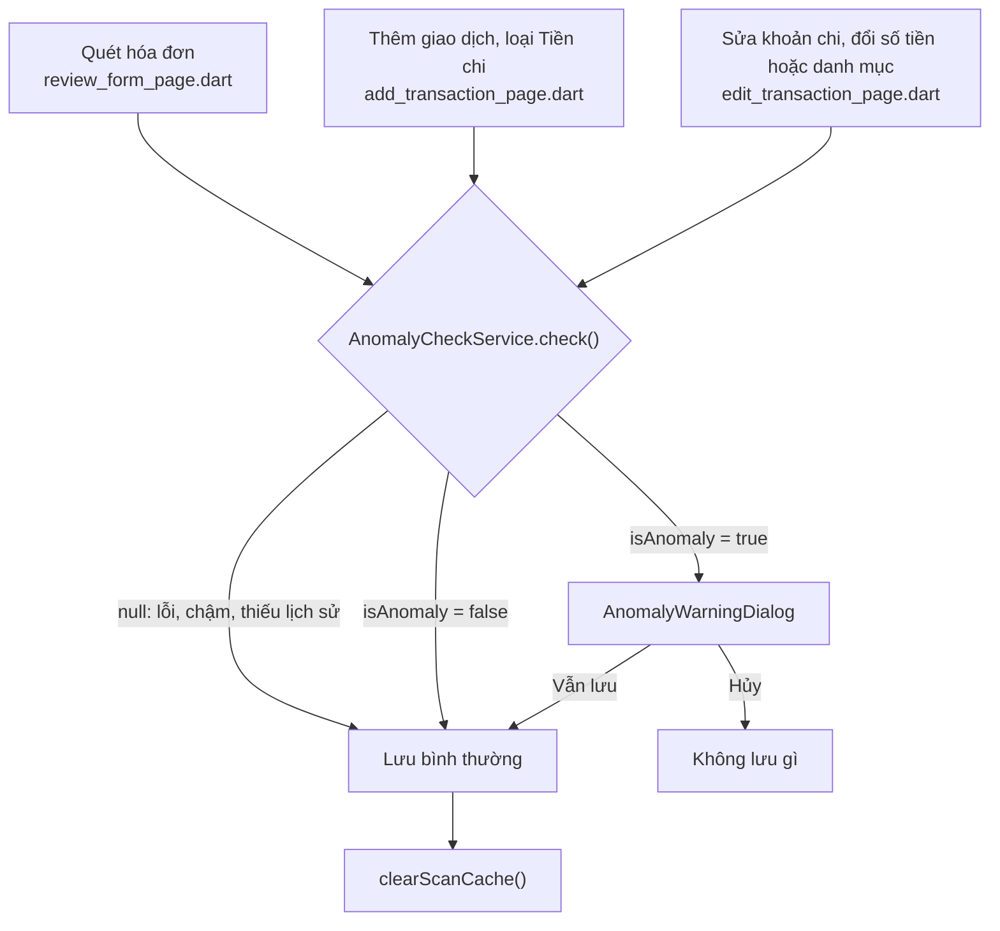

# 07. Tích hợp vào ứng dụng Flutter

Đường dẫn trong tài liệu này tính từ gốc repo.

## 1. Điều kiện để app kiểm tra

App chỉ gọi API Big Data khi cả hai điều kiện đúng:

- App chạy chế độ server (`AppConfig.isFull`). Ở chế độ demo cục bộ (sqflite) không có lịch sử trên server nên không kiểm tra.
- Có địa chỉ API: build với `--dart-define=FRAUD_API_URL=http://<máy>:8001`. Đây là base URL, không kèm path. Dấu `/` ở cuối được bỏ tự động.

Thiếu một trong hai, mọi hàm kiểm tra trả `null` ngay và app lưu như chưa từng có tính năng này.

## 2. `AnomalyCheckService`

File: `mobile-app/lib/services/anomaly_check_service.dart`. Hai hàm tĩnh.

### 2.1 `check()`: trước khi lưu một khoản chi

| Bước | Chi tiết |
|---|---|
| 1 | Lấy giao dịch của người dùng từ core-backend: `GET /api/transactions/mine` |
| 2 | Giữ khoản chi có số tiền dương, sắp mới nhất trước, lấy 100 |
| 3 | `POST {FRAUD_API_URL}/v2/predict-anomaly` với `current` (số tiền, thời điểm dạng `yyyy-MM-ddTHH:mm:ss`, tên danh mục tiếng Việt) và `history` |
| 4 | Timeout 3 giây cho kết nối, gửi và nhận |
| 5 | Đọc kết quả bằng `AnomalyResult.fromJson`. Nếu `scored` khác `true` hoặc thiếu `isAnomaly`, `riskScore`, `threshold` đúng kiểu thì coi như không có kết quả |

App không tự tính feature. Nó chỉ gửi giao dịch thô, server tính bằng đúng công thức lúc huấn luyện.

Lịch sử gửi lên có thể chứa giao dịch sau thời điểm đang xét (khi sửa một giao dịch cũ). Server tự bỏ những giao dịch đó. Khi sửa, chính bản cũ của giao dịch cũng có trong lịch sử, nhưng nó cùng thời điểm với giao dịch đang xét nên bị loại theo quy tắc "trước nghiêm ngặt".

### 2.2 `scanHistory()`: màn hình nghi vấn, tab AI, Trang chủ

| Bước | Chi tiết |
|---|---|
| 1 | Lấy giao dịch từ core-backend như trên |
| 2 | Giữ khoản chi có số tiền dương, lấy 1.000 khoản mới nhất, kèm `id` |
| 3 | `POST {FRAUD_API_URL}/v2/scan-history`, timeout 10 giây |
| 4 | Đọc bằng `AnomalyScan.fromJson` |
| 5 | Lưu đệm trong phiên với khóa "số giao dịch + ngày giao dịch mới nhất". Mở lại màn hình mà dữ liệu chưa đổi thì dùng kết quả cũ |

Mỗi lần lưu thành công một giao dịch (quét, nhập tay, sửa), app gọi `clearScanCache()` để lần mở sau quét lại. Kéo xuống trên màn hình nghi vấn cũng ép quét lại.

### 2.3 Fail-open

Mọi lỗi đều trả `null` và app lưu bình thường, không hiện hộp thoại:

| Tình huống | Kết quả |
|---|---|
| Chưa cấu hình `FRAUD_API_URL` hoặc ở chế độ demo | Không gọi API |
| Không lấy được lịch sử từ core-backend | Không kiểm tra |
| API tắt, mất mạng | Không kiểm tra |
| API quá 3 giây | Không kiểm tra |
| API trả 4xx, 5xx, body lạ | Không kiểm tra |
| `scored: false` (dưới 5 giao dịch) | Không kiểm tra |

App chỉ ghi log loại lỗi (`error.runtimeType`), không ghi số tiền hay nội dung hóa đơn.

## 3. Ba đường nhập khoản chi

Cả ba đường hỏi cùng một câu qua `AnomalyWarningDialog.confirm()`, nên chữ và nút giống hệt nhau.



### 3.1 Quét hóa đơn (`mobile-app/lib/screens/receipt_scanner/review_form_page.dart`)

1. Người dùng chọn "Quét hóa đơn bằng AI", rồi "Quét AI" (máy quét tài liệu) hoặc "Từ thư viện".
2. Màn hình "Xác nhận hóa đơn" gửi ảnh tới ai-service (DONUT) để đọc tên cửa hàng, thời gian và tổng tiền. OCR lỗi thì hiện "Quét hóa đơn thất bại (Kiểm tra AI service). Vui lòng nhập tay.", không đọc được tổng thì hiện "Donut chưa đọc được tổng tiền từ ảnh — vui lòng nhập tay."
3. Cạnh dòng "TỔNG TIỀN:" có nút bút chì (tooltip "Sửa tổng tiền"). Bấm vào mở hộp thoại "Sửa tổng tiền", ô "Tổng tiền (đ)", hai nút Hủy và Áp dụng. Số đã nhập thắng số OCR đọc được, và cạnh tổng tiền hiện nhãn "(đã sửa)".
4. Số tiền dùng để kiểm tra và để lưu: số người dùng sửa, nếu không thì tổng DONUT đọc được, nếu không thì tổng tính từ các dòng hàng.
5. Bấm "Xác nhận & Lưu CSDL": app đọc thời điểm trong ô ngày (`dd/MM/yyyy HH:mm`, lỗi thì dùng giờ hiện tại), gọi `check()` với danh mục đang chọn (mặc định "Ăn uống").
6. Bị gắn cờ: hộp thoại cảnh báo. Hủy thì ở lại màn hình, không lưu. Vẫn lưu thì gửi `POST /api/transactions/checkout` với đúng số tiền đã khai, kèm dữ liệu OCR thô và ảnh.

Nút bút chì có hai công dụng: sửa khi OCR đọc sai, và tái hiện tình huống "khai khống" khi demo mà không cần dựng dịch vụ OCR giả.

### 3.2 Nhập tay (`mobile-app/lib/screens/ledger/add_transaction_page.dart`)

Màn hình "Thêm giao dịch". Chỉ kiểm tra khi loại là "Tiền chi". "Tiền thu" không kiểm tra, vì mô hình chỉ học khoản chi. Thời điểm kiểm tra là ngày người dùng chọn. Bấm "Lưu giao dịch" thì kiểm tra rồi mới lưu.

Lý do có đường này: nếu chỉ kiểm tra lúc quét hóa đơn, người dùng có thể bỏ qua cảnh báo bằng cách nhập tay.

### 3.3 Sửa (`mobile-app/lib/screens/ledger/edit_transaction_page.dart`)

Màn hình "Sửa giao dịch", nút "Lưu thay đổi". Chỉ kiểm tra khi giao dịch gốc là khoản chi và người dùng đổi số tiền hoặc danh mục. Chỉ đổi ghi chú thì không kiểm tra. Thời điểm kiểm tra là ngày của chính giao dịch đó, không phải hôm nay, để so với thói quen ở thời điểm ấy.

Lý do có đường này: nếu không, người dùng có thể lưu một số nhỏ rồi sửa thành số lớn.

## 4. Hộp thoại cảnh báo

File: `mobile-app/lib/widgets/dialogs/anomaly_warning_dialog.dart`.

```text
⚠  Chi tiêu bất thường so với thói quen

1.200.000 đ
Số tiền gấp 11,1 lần mức chi trung bình của bạn.
Điểm rủi ro: 97.9% (ngưỡng cảnh báo 96.1%)

Bạn có muốn tiếp tục lưu không?

                         [Hủy]   [Vẫn lưu]
```

Phần trăm dùng `toStringAsFixed(1)` nên hiện dấu chấm thập phân, còn câu giải thích của API dùng dấu phẩy.

- Số tiền định dạng tiếng Việt, ký hiệu đ.
- Câu giải thích lấy nguyên văn từ API.
- Nếu `flaggedBy = "model"`: dòng "Điểm rủi ro: X% (ngưỡng cảnh báo Y%)".
- Nếu `flaggedBy = "rule"`: dòng "Khoản này vượt xa mức bạn thường chi nên cần bạn xác nhận." Không hiện điểm rủi ro, vì điểm của mô hình trong trường hợp này rất thấp và dễ gây hiểu nhầm.
- Không đóng được bằng cách chạm ra ngoài. Người dùng phải chọn Hủy hoặc Vẫn lưu.

## 5. Màn hình giao dịch nghi vấn

File: `mobile-app/lib/screens/ai/suspicious_transactions_page.dart`, tiêu đề "Cảnh báo chi tiêu bất thường".

Hai đường vào:

- Trang chủ (`dashboard_page.dart`): banner đỏ "Có N giao dịch chi tiêu bất thường". Banner chỉ hiện khi lần quét thành công và có ít nhất một giao dịch bị gắn cờ. Lỗi hoặc không có gì thì ẩn.
- Tab AI (`ai_tab_page.dart`): thẻ "Cảnh báo chi tiêu bất thường", luôn hiện, dòng phụ đổi theo trạng thái:
  - chưa có kết quả: "Nhấn để kiểm tra các giao dịch khác thói quen của bạn."
  - chưa đủ dữ liệu: "Cần ít nhất 5 giao dịch để phân tích thói quen."
  - không có gì: "Không có giao dịch bất thường."
  - có: "N giao dịch có dấu hiệu bất thường. Nhấn để xem."

Các trạng thái của màn hình:

| Trạng thái | Hiển thị |
|---|---|
| Đang quét | Vòng xoay |
| API lỗi hoặc không cấu hình | "Chưa kiểm tra được", "Không kết nối được dịch vụ phân tích. Hãy thử lại sau.", nút "Thử lại" |
| Không giao dịch nào đủ lịch sử | "Chưa đủ dữ liệu", "Cần ít nhất 5 giao dịch để phân tích thói quen" |
| Không giao dịch nào bị gắn cờ | "Không có giao dịch bất thường", "Đã kiểm tra N giao dịch, tất cả đều phù hợp với thói quen của bạn." |
| Có giao dịch bị gắn cờ | Tiêu đề "X/Y giao dịch có dấu hiệu bất thường", dòng "Mô hình: behavior-gbt-...", biểu đồ cột số giao dịch bị gắn cờ theo danh mục, rồi danh sách |

Mỗi dòng trong danh sách: tên danh mục, số tiền (màu đỏ), ngày giờ, rồi:

- nếu do mô hình: thanh "Rủi ro" với phần trăm;
- nếu do luật: nhãn "Vượt xa mức chi thường ngày" thay cho thanh rủi ro;
- câu giải thích.

Danh sách xếp theo điểm giảm dần (do API sắp). Kéo xuống để quét lại.

## 6. Chạy app với API Big Data

Ví dụ trên điện thoại Android cắm cáp, backend và API chạy trên máy tính:

```bash
adb reverse tcp:8080 tcp:8080     # core-backend
adb reverse tcp:8001 tcp:8001     # fraud-api
cd mobile-app
flutter run --dart-define=API_BASE=http://localhost:8080 --dart-define=FRAUD_API_URL=http://localhost:8001
```

Trên máy ảo Android dùng `10.0.2.2` thay cho `localhost`. Trên điện thoại dùng Wi-Fi thì dùng IP LAN của máy tính.

Tài khoản mới chưa có lịch sử nên sẽ không bao giờ bị cảnh báo. Tạo lịch sử bằng:

```bash
python BigData/BigData/scripts/seed_demo_history.py --base-url http://localhost:8080 --email <email> --password <mật khẩu>
```

Script đăng nhập rồi tạo khoảng 30 ngày chi tiêu thói quen (ăn trưa 40 đến 70 nghìn, đi chợ cuối tuần 280 đến 320 nghìn, đổ xăng mỗi tuần) và 3 khoản bất thường (mua sắm 2,4 triệu lúc 23:45, tiệc nhà hàng 1,5 triệu, hóa đơn 3 triệu lúc 2:30). Nó tạo giao dịch thật qua `POST /api/transactions/checkout` và trừ số dư ví, nên chỉ dùng cho tài khoản demo.

## 7. Kiểm thử phía app

44 case trong `mobile-app/test/bigdata_cases/`, chia mức L1 đến L5, chạy bằng `bash test/bigdata_cases/run_in_order.sh` từ thư mục `mobile-app/`. Chi tiết ở `08_KIEM_THU_VAN_HANH.md`.
