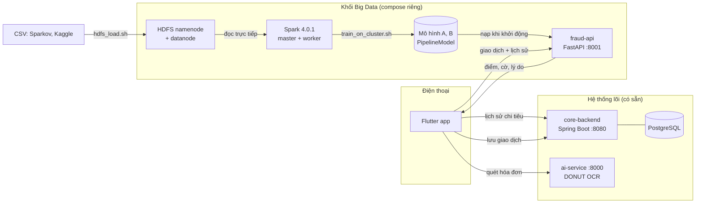
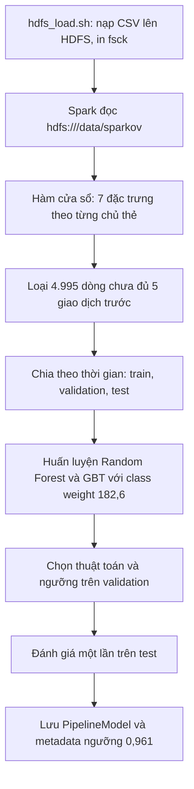
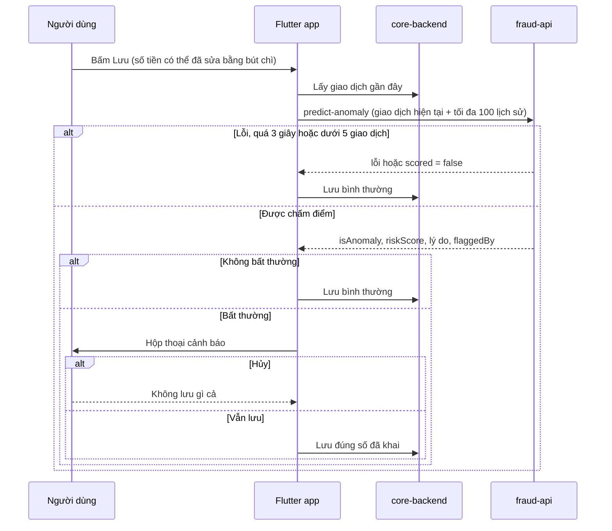

# Hướng dẫn cho nhóm: hệ thống phát hiện chi tiêu bất thường (Big Data)

Tài liệu này dành cho các thành viên cần nắm toàn bộ phần Big Data của DonutPay trước buổi bảo vệ. Đọc xong bạn phải trả lời được ba câu: hệ thống có những tính năng gì, các khối nối với nhau ra sao, và mỗi tiêu chí trong barem được chứng minh bằng cái gì. Số liệu lấy từ các file kết quả trong repo (`artifacts/behavior/metrics_behavior.json`, `metrics.json`) và khớp với báo cáo Word. Chi tiết số liệu đầy đủ nằm ở `docs/REPORT_NOTES.md`.

## 1. Bài toán và phạm vi

DonutPay là ứng dụng quản lý chi tiêu cá nhân (Flutter). Đề tài thêm một lớp cảnh báo: khi người dùng ghi một khoản chi lệch xa thói quen của chính họ, ứng dụng hỏi lại trước khi lưu.

Ba điều cần nhớ khi trả lời hội đồng:

- Dữ liệu huấn luyện là Sparkov, một bộ giao dịch thẻ do bộ sinh mô phỏng tạo ra (1,85 triệu dòng). Dữ liệu chi tiêu cá nhân có nhãn gian lận không được công bố, nên nhóm không có lựa chọn khác. Nhóm nói thẳng điều này trong báo cáo.
- Hệ thống là suy luận trực tuyến (online inference): mô hình huấn luyện sẵn bằng Spark, API chấm từng giao dịch khi người dùng bấm Lưu. Nhóm không làm Kafka hay Spark Streaming và không gọi đó là thời gian thực theo nghĩa luồng.
- Cảnh báo chỉ để người dùng cân nhắc. Người dùng chọn Vẫn lưu thì giao dịch vào cơ sở dữ liệu như bình thường.

## 2. Các tính năng

### 2.1 Hạ tầng và xử lý dữ liệu lớn

| Tính năng | Chi tiết |
|---|---|
| Lưu trữ HDFS thật | Namenode và datanode chạy bằng Docker (image Hadoop 3.4.1). Dữ liệu gốc 622,2 MB nằm ở `hdfs:///data/`, khối 128 MB, `fsck` báo HEALTHY. Chỉ có một datanode vì chạy trên một máy. |
| Cụm Spark | Spark 4.0.1 standalone, một master và một worker 4 core. Spark đọc thẳng từ HDFS, không qua ổ đĩa cục bộ. |
| Đặc trưng hành vi bằng hàm cửa sổ | Với mỗi giao dịch, Spark so với tối đa 100 giao dịch trước đó của cùng người dùng (`Window.partitionBy` kèm `filter`, `aggregate`, `slice`). Chạy phân tán trên 1,85 triệu dòng. |
| Xử lý mất cân bằng | Class weight 182,6 cho lớp gian lận ở mô hình B (577,9 ở mô hình A). |
| Chia dữ liệu theo thời gian | Không xáo trộn. Train 1.162.460 dòng (6.333 gian lận), validation 129.300 dòng, test 555.639 dòng. Mốc cắt validation: 2020-05-02. |
| Phân tích khám phá | Notebook `behavior_anomaly_pipeline.ipynb` dùng `groupBy` phân tán, chỉ đưa số liệu tổng hợp về driver để vẽ biểu đồ: ba biểu đồ phân tích khám phá (Hình 3.5 đến 3.7) và hai biểu đồ đánh giá mô hình (Hình 3.8, 3.9). |

### 2.2 Hai mô hình, hai vai trò

| | Mô hình A | Mô hình B |
|---|---|---|
| Vai trò | Đo đạc, chuẩn so sánh kỹ thuật | Chạy trong ứng dụng |
| Dữ liệu | Kaggle Credit Card, 284.807 dòng, 30 đặc trưng (Time, V1 đến V28, Amount) | Sparkov, 1.852.394 dòng, 7 đặc trưng hành vi |
| Thuật toán | Random Forest, 100 cây, sâu tối đa 5 | Gradient Boosted Trees (chọn trên PR-AUC của validation, hơn Random Forest 0,754 so với 0,700) |
| Kết quả test | PR-AUC 0,689, Precision 0,365, Recall 0,795 | PR-AUC 0,654, Precision 0,591, Recall 0,671, F1 0,629, ngưỡng 0,961 |
| App có gọi không | Không | Có |

Mô hình A có một thí nghiệm quan trọng cho phần bảo vệ: thay V1 đến V28 bằng 0 (đúng thứ mà một ứng dụng chỉ biết số tiền và thời gian sẽ gửi) thì Recall rơi về 0. Đó là bằng chứng số liệu cho việc phải làm mô hình B. Không bao giờ điền 0 vào các biến PCA trong ứng dụng.

Không so sánh trực tiếp chỉ số của A với B: dữ liệu và tập kiểm thử khác nhau.

Bảng so sánh các phương pháp của mô hình B trên tập kiểm thử:

| Phương pháp | PR-AUC | Precision | Recall | F1 |
|---|---|---|---|---|
| GBT (được chọn) | 0,654 | 0,591 | 0,671 | 0,629 |
| Random Forest | 0,616 | 0,610 | 0,608 | 0,609 |
| Luật số tiền gấp 3 lần trung bình cùng danh mục | không có | 0,027 | 0,492 | 0,051 |

Ma trận nhầm lẫn của GBT: TP 1.385, FP 957, FN 680, TN 552.617. Chỉ khoảng 0,42% giao dịch bị cảnh báo. PR-AUC 0,654 cao gấp khoảng 170 lần mức của bộ phân loại ngẫu nhiên (tỷ lệ gian lận khoảng 0,39%), nhưng vẫn là mức vừa phải. Báo cáo không trình bày đó là hệ thống hoàn hảo.

Bảy đặc trưng của mô hình B: `hour`, `day_of_week`, `category_idx`, `amt_ratio_user`, `amt_ratio_user_cat`, `txn_count_24h`, `secs_since_prev`. Dùng tỷ lệ thay vì số tiền tuyệt đối để không phụ thuộc đơn vị tiền (USD trong Sparkov, VND trong app). Ba đặc trưng quan trọng nhất của GBT là `amt_ratio_user` (0,39), `category_idx` (0,23) và `hour` (0,17).

### 2.3 API (FastAPI, cổng 8001)

| Endpoint | Việc làm |
|---|---|
| `GET /health` | Cho biết cả hai mô hình đã nạp chưa |
| `POST /v2/predict-anomaly` | Nhận giao dịch hiện tại cùng tối đa 200 giao dịch lịch sử. Chỉ giữ giao dịch xảy ra trước thời điểm hiện tại, lấy 100 gần nhất, tính 7 đặc trưng, chấm điểm. Trả về `isAnomaly`, `riskScore`, `threshold`, `explanation` (tiếng Việt), `flaggedBy`. Dưới 5 giao dịch trước đó thì trả `scored: false`. |
| `POST /v2/scan-history` | Nhận tối đa 1.000 giao dịch, sắp xếp một lần, chấm cả lô bằng một lần `transform`. Trả về số lượng quét, số lượng được chấm, số bị gắn cờ, số bị gắn cờ theo danh mục, danh sách giao dịch nghi vấn. |
| `POST /predict-fraud` | Đường vào của mô hình A, chỉ dùng cho benchmark và đối chứng |

Dữ liệu đầu vào được kiểm tra chặt bằng Pydantic: từ chối trường lạ, số tiền phải dương và hữu hạn. API không ghi log số tiền hay danh mục.

Luật chặn thói quen (`HABIT_GUARD_RATIO = 10` trong `behavior_features.py`): mô hình B cho điểm khoảng 0,02 với mọi số tiền ở danh mục ăn uống, vì Sparkov gần như không có gian lận ở đó (trên tập test chỉ có 4 dòng với tỷ lệ từ 10 lần trở lên ở `food_dining`, cả 4 đều bình thường). Nên API còn gắn cờ khi số tiền từ 10 lần trở lên so với cả mức trung bình của người dùng lẫn của danh mục, và ghi `flaggedBy: "rule"` để biết cảnh báo do luật tạo ra chứ không phải do mô hình. Ngưỡng 10 lần do nhóm chọn, chưa kiểm chứng trên dữ liệu người dùng thật.

### 2.4 Ứng dụng Flutter

| Tính năng | Mô tả |
|---|---|
| Cảnh báo khi quét hóa đơn | Màn hình xác nhận hóa đơn hỏi API trước khi lưu. Nếu bất thường, hiện hộp thoại "Chi tiêu bất thường so với thói quen" kèm lý do và hai lựa chọn Hủy hoặc Vẫn lưu. |
| Nút bút chì | Cạnh dòng "TỔNG TIỀN" trên màn hình xác nhận. Người dùng tự khai lại số tiền, ứng dụng chấm điểm và lưu theo số đã khai, nhãn "(đã sửa)". Cũng dùng khi OCR đọc sai hoặc ra 0. Nhờ nút này, demo không cần dựng dịch vụ OCR giả. |
| Cảnh báo khi nhập tay | Form Thêm giao dịch, với khoản chi (không áp dụng cho khoản thu). |
| Cảnh báo khi sửa | Form Sửa giao dịch, khi đổi số tiền hoặc danh mục của khoản chi. Kiểm tra theo ngày của chính giao dịch đó, không theo hôm nay. |
| Màn hình giao dịch nghi vấn | Banner ở Trang chủ và thẻ trong tab AI dẫn tới trang chi tiết: tóm tắt "X trên Y giao dịch có dấu hiệu bất thường", biểu đồ cột theo danh mục, danh sách có thanh điểm rủi ro. Quét lại mỗi lần mở, có lưu đệm trong phiên. |
| An toàn cho người dùng | Lỗi mạng, quá 3 giây, API trả lỗi, thiếu lịch sử: lưu bình thường, không hộp thoại, không chặn. |

## 3. Kiến trúc

### 3.1 Các khối và cách nối



Khối Big Data chạy độc lập bằng `docker-compose.bigdata.yml`. Nó không đụng vào core-backend hay cơ sở dữ liệu của app. Ứng dụng chỉ gọi API qua địa chỉ cấu hình ở `FRAUD_API_URL`. Nếu không cấu hình, app bỏ qua bước kiểm tra.

| Khối | Công nghệ | Cổng | Vai trò |
|---|---|---|---|
| `mobile-app/` | Flutter, Dio | | Ứng dụng người dùng |
| `core-backend/` | Spring Boot, PostgreSQL, Redis | 8080 | Nguồn dữ liệu giao dịch, ngân sách, thanh toán |
| `ai-service/` | FastAPI | 8000 | OCR hóa đơn (DONUT), phân tích chi tiêu (SPADE) |
| `BigData/BigData/` | HDFS, Spark, FastAPI | 8001 | Huấn luyện và phục vụ mô hình bất thường |
| HDFS UI, Spark UI | | 9870, 8080 | Chụp bằng chứng cho báo cáo |

Lưu ý khi chạy chung một máy: Spark master và core-backend cùng muốn cổng 8080. Khi demo trên máy cá nhân, chỉ bật `fraud-api` (profile `api`), không bật cả cụm Spark.

### 3.2 Hợp đồng đặc trưng giữa hai phía

Cùng một công thức đặc trưng được cài hai lần: bằng Spark để huấn luyện (`behavior_features_spark.py`) và bằng Python thuần để phục vụ (`behavior_features.py`). Hai bản phải cho cùng số. Quy ước chung:

- Cửa sổ lịch sử là 100 giao dịch gần nhất, chỉ tính các giao dịch trước thời điểm hiện tại (nghiêm ngặt).
- Dưới 5 giao dịch trước đó là cold start, không chấm điểm.
- Thời gian là datetime cục bộ không có múi giờ, hai phía đều đọc như UTC.
- Danh mục tiếng Việt của app được ánh xạ sang 14 danh mục Sparkov bằng từ khóa (so khớp từ nguyên vẹn). Danh mục không khớp rơi vào `misc_pos`.

Đổi bất kỳ đặc trưng nào thì phải huấn luyện lại và chạy lại `scripts/e2e_check.py`. Script này phát lại 30 mẫu do Spark tính, và đặc trưng cùng xác suất phải khớp tuyệt đối.

## 4. Các luồng chính

### 4.1 Luồng huấn luyện (chạy một lần, khoảng 6 phút cho mô hình B)



### 4.2 Luồng suy luận khi người dùng lưu một khoản chi

Áp dụng giống nhau cho ba đường: quét hóa đơn, thêm tay, sửa giao dịch.



Bên trong `predict-anomaly`: lọc lịch sử trước thời điểm hiện tại, tính 7 đặc trưng, chấm bằng GBT, so với ngưỡng 0,961. Nếu mô hình không gắn cờ nhưng số tiền từ 10 lần trở lên so với cả hai mức trung bình thì luật gắn cờ. Lý do hiển thị được sinh theo luật từ giá trị đặc trưng (ví dụ "Số tiền gấp 11,1 lần mức chi trung bình của bạn").

### 4.3 Luồng màn hình giao dịch nghi vấn

Mở banner hoặc thẻ AI, app gửi tối đa 1.000 khoản chi gần nhất tới `scan-history`, API chấm cả lô, app vẽ biểu đồ theo danh mục và danh sách theo điểm giảm dần. Giao dịch do luật gắn cờ hiện nhãn "Vượt xa mức chi thường ngày" thay vì thanh điểm rủi ro, vì điểm của mô hình ở những dòng này thấp và dễ gây hiểu nhầm.

## 5. Đối chiếu với barem

Barem là rubric chung, thang 10, 6 tiêu chí. Đồ án chấm hai giai đoạn (tiến độ và lý thuyết 30%, hoàn chỉnh 70%) cùng một rubric.

| Tiêu chí | Điểm | Bằng chứng | Chỗ xem |
|---|---|---|---|
| Tính ứng dụng của kỹ thuật (CLO1) | 1,0 | Kỹ thuật Big Data giải một bài toán cụ thể và nối vào ứng dụng thật, lỗi dịch vụ không làm hỏng việc lưu | App, API, mục 4.2 của tài liệu này |
| Lưu trữ và xử lý dữ liệu (CLO2) | 2,0 | HDFS thật 622,2 MB, `fsck` HEALTHY, Spark đọc từ HDFS, hàm cửa sổ trên 1,85 triệu dòng, chia theo thời gian, xử lý mất cân bằng | `scripts/hdfs_load.sh`, `train_behavior.py`, UI 9870 và 8080 |
| Mô hình và công nghệ (CLO3) | 2,5 | Hai mô hình có vai trò riêng, so sánh RF, GBT, luật; chọn mô hình và ngưỡng trên validation; thí nghiệm điền 0; xác suất của API khớp Spark | `metrics_behavior.json`, `metrics.json`, `e2e_check.py` |
| Trực quan hóa và ứng dụng (CLO3) | 2,5 | Ba biểu đồ phân tích khám phá và hai biểu đồ đánh giá mô hình, Swagger, hộp thoại cảnh báo, nút bút chì, banner, thẻ AI, màn hình nghi vấn có biểu đồ | Notebook, `mobile-app/lib/screens/` |
| Trình bày báo cáo (CLO4) | 1,0 | Năm chương, danh mục hình bảng, phần hạn chế nêu thẳng, phụ lục chạy lại | `Nhom7_BigData.docx` (không đưa lên git) |
| Phân công và phối hợp (CLO5) | 1,0 | Phụ lục A: bảng phân công và ma trận đánh giá chéo | Nhóm tự hoàn thiện |

## 6. Cách chạy lại hệ thống

Chạy từ thư mục `BigData/BigData`. Trên Git Bash cho Windows, thêm `MSYS_NO_PATHCONV=1` trước các script.

```bash
# 1. HDFS và Spark (cần khoảng 8 GB RAM)
docker compose -f docker-compose.bigdata.yml up -d --build
bash scripts/hdfs_load.sh                      # nạp CSV, in dung lượng và fsck

# 2. Huấn luyện
bash scripts/train_on_cluster.sh behavior      # mô hình B
bash scripts/train_on_cluster.sh creditcard    # mô hình A và thí nghiệm điền 0

# 3. API
docker compose -f docker-compose.bigdata.yml --profile api up -d --build fraud-api
curl http://127.0.0.1:8001/health              # phải thấy behaviorModelLoaded: true

# 4. Kiểm thử đầu cuối (20 check)
python -X utf8 scripts/e2e_check.py --base-url http://127.0.0.1:8001
```

Dữ liệu thô (`fraudTrain.csv`, `fraudTest.csv`, `creditcard.csv`) tải từ Kaggle, không có trên git.

Chạy ứng dụng trên điện thoại Android:

```bash
adb reverse tcp:8080 tcp:8080
adb reverse tcp:8001 tcp:8001
cd ../../mobile-app    # từ BigData/BigData
flutter run --dart-define=API_BASE=http://localhost:8080 --dart-define=FRAUD_API_URL=http://localhost:8001
```

Tạo dữ liệu demo cho một tài khoản thử: `python scripts/seed_demo_history.py --email ... --password ...`. Trên máy ảo Android dùng `10.0.2.2` thay cho `localhost`. Nếu không đặt `FRAUD_API_URL`, app lưu bình thường và không kiểm tra gì.

## 7. Kiểm thử

### 7.1 Kiểm thử tự động, xếp từ xấu nhất đến tốt nhất

Chạy từ `mobile-app/` với `fraud-api` đang bật:

```bash
bash test/bigdata_cases/run_in_order.sh
```

Script dừng ở mức đầu tiên bị lỗi, vì một mức chỉ có nghĩa khi các mức dưới nó đã xanh.

| Mức | Nội dung | Số case | Dùng mô hình thật |
|---|---|---|---|
| L0 | API đã nạp mô hình, `e2e_check.py` đạt | 20 check | Có |
| L1 | Dịch vụ sập, treo, trả 500, trả body lạ; backend lỗi; lịch sử dưới 5 giao dịch | 9 | Một phần |
| L2 | Hợp đồng dữ liệu: payload, cắt lịch sử 100 và 1.000, thứ tự, bỏ khoản thu | 9 | Có |
| L3 | Phán đoán của mô hình: bình thường, bất thường, khai khống, sửa giao dịch, màn hình nghi vấn | 8 | Có |
| L4 | Ba đường nhập khi bị gắn cờ: Hủy không lưu gì, Vẫn lưu đúng số đã khai, bút chì | 14 | Không (đáp án giả) |
| L5 | Luồng bình thường không hiện cảnh báo | 4 | Không (đáp án giả) |

Cần nói rõ khi bảo vệ: L4 và L5 giả đáp án của mô hình để dựng được hộp thoại theo ý muốn. Phán đoán thật của mô hình được kiểm ở L3.

### 7.2 Kịch bản thủ công trên điện thoại (chưa chạy)

Cần chạy rồi điền kết quả vào Bảng 4.2 của báo cáo. Thứ tự từ xấu đến tốt:

1. Tắt `fraud-api`, lưu một khoản chi lớn ở cả ba đường: không cảnh báo, vẫn lưu.
2. Tài khoản mới dưới 5 giao dịch, lưu khoản chi lớn: không cảnh báo, vẫn lưu.
3. OCR lỗi hoặc ra 0, dùng bút chì nhập số tiền: dùng số đã nhập, có nhãn "(đã sửa)".
4. Quét hóa đơn, bút chì, khai số rất lớn, Lưu: hiện cảnh báo. Hủy thì không lưu, Vẫn lưu thì lưu đúng số đã khai.
5. Thêm giao dịch loại Tiền chi với số rất lớn: cùng hộp thoại.
6. Sửa khoản chi, tăng số tiền; làm thêm một lần chỉ đổi ghi chú: lần đầu có cảnh báo, lần sau không.
7. Thêm giao dịch loại Tiền thu số lớn: không cảnh báo.
8. Mở banner Trang chủ hoặc thẻ tab AI sau khi lưu giao dịch bất thường: giao dịch có trong danh sách bị gắn cờ.
9. Quét hóa đơn bình thường, giữ nguyên số tiền: không hộp thoại, giao dịch lưu.

"Rất lớn" nghĩa là từ khoảng 10 lần mức chi trung bình của tài khoản trở lên. Nếu chưa thấy cảnh báo, tăng số tiền thêm.

## 8. Giới hạn đã biết

Nêu thẳng những điều này khi hội đồng hỏi, đừng để họ phát hiện trước.

- Dữ liệu huấn luyện là mô phỏng, thói quen người dùng Việt Nam có thể khác. Kết quả chưa kiểm chứng trên dữ liệu chi tiêu thật.
- PR-AUC 0,654 và Precision 0,591 nghĩa là khoảng 4 trong 10 cảnh báo là nhầm và khoảng 33% bất thường bị bỏ sót.
- Hạ tầng một nút: một datanode (replication 1) và một worker. Khả năng chịu lỗi và mở rộng ngang chưa được kiểm chứng.
- Ánh xạ danh mục bằng từ khóa, nên danh mục lạ rơi vào `misc_pos`.
- Mô hình bỏ lọt khai khống ở danh mục ăn uống, nên có luật chặn. Luật chặn làm một phần cảnh báo không còn đến từ mô hình, và ngưỡng 10 lần chưa kiểm chứng. Khoản chi dưới 10 lần mức trung bình ở những danh mục như ăn uống vẫn có thể lọt (với người dùng thử nghiệm chi trung bình khoảng 108 nghìn, bữa trưa 1 triệu chưa bị gắn cờ).
- Cảnh báo chỉ mang tính tư vấn. Hệ thống lõi không xét điểm rủi ro, nên ai gọi thẳng API tạo giao dịch vẫn lưu được số tiền khai khống. Điểm số không được lưu nên chưa có lịch sử "đã cảnh báo lúc nào".
- Đây là suy luận trực tuyến, chưa có xử lý luồng.

## 9. Việc còn lại trước khi nộp

- Chụp ảnh nút bút chì cho Hình 4.3 trong báo cáo.
- Chụp lại ảnh kết quả `e2e_check.py` (Hình 4.8), vì ảnh cũ là bản 18/18 và bản hiện tại là 20/20.
- Chạy 9 kịch bản thủ công ở mục 7.2 và điền Bảng 4.2.
- Cập nhật mục lục và danh mục hình, bảng trong Word (Ctrl+A rồi F9).
- Báo cáo cần nhắc luật chặn thói quen và lý do tồn tại của nó.
- Hoàn thiện Phụ lục A: phân công và đánh giá chéo.

## 10. Bản đồ mã nguồn

| Muốn tìm | Mở |
|---|---|
| Đặc trưng khi huấn luyện (Spark) | `BigData/BigData/behavior_features_spark.py` |
| Đặc trưng khi phục vụ (Python), luật chặn, lời giải thích | `BigData/BigData/behavior_features.py` |
| Huấn luyện mô hình B | `BigData/BigData/train_behavior.py` |
| Huấn luyện mô hình A, thí nghiệm điền 0 | `BigData/BigData/train_pipeline.py` |
| API mô hình B | `BigData/BigData/behavior_api.py` |
| Kiểm thử đầu cuối của API | `BigData/BigData/scripts/e2e_check.py` |
| Số liệu để chép vào báo cáo | `BigData/BigData/docs/REPORT_NOTES.md` |
| Sơ đồ kiến trúc và luồng dữ liệu | `docs/architecture/*.html` |
| Dịch vụ gọi API từ app | `mobile-app/lib/services/anomaly_check_service.dart` |
| Hộp thoại cảnh báo dùng chung | `mobile-app/lib/widgets/dialogs/anomaly_warning_dialog.dart` |
| Quét hóa đơn và nút bút chì | `mobile-app/lib/screens/receipt_scanner/review_form_page.dart` |
| Nhập tay, sửa giao dịch | `mobile-app/lib/screens/ledger/add_transaction_page.dart`, `edit_transaction_page.dart` |
| Màn hình giao dịch nghi vấn | `mobile-app/lib/screens/ai/suspicious_transactions_page.dart` |
| Các case kiểm thử theo mức | `mobile-app/test/bigdata_cases/` |
