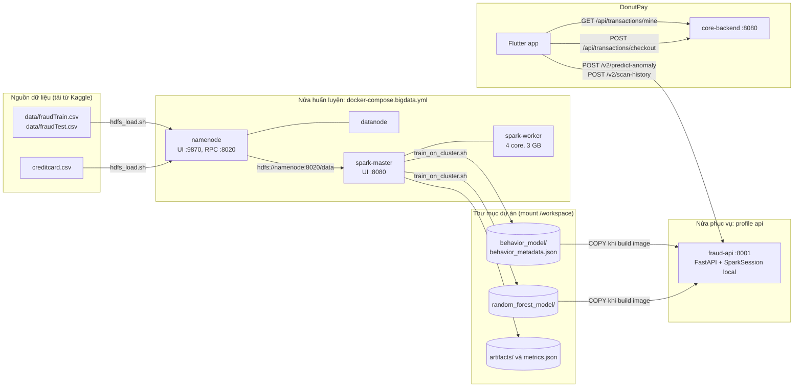

# 01. Kiến trúc

## 1. Hai nửa của hệ thống

Phần Big Data chạy ở hai thời điểm khác nhau và dùng hai bộ máy khác nhau.

| | Nửa huấn luyện (offline) | Nửa phục vụ (online) |
|---|---|---|
| Chạy khi nào | Một lần, khi có dữ liệu mới hoặc đổi feature | Mỗi lần người dùng lưu một khoản chi hoặc mở màn hình nghi vấn |
| Thành phần | HDFS (namenode, datanode) và cụm Spark (master, worker) | Container `fraud-api` (FastAPI) |
| Đầu vào | File CSV trên HDFS | Một giao dịch và lịch sử của người dùng, gửi từ app |
| Đầu ra | Thư mục mô hình và file số liệu trên đĩa | Điểm rủi ro, cờ bất thường, câu giải thích |
| Thời gian | Khoảng 370 giây cho Model B | Vài trăm mili giây mỗi request |

Hai nửa nối với nhau bằng hai thứ:

- Thư mục mô hình: `behavior_model/` (Model B) và `random_forest_model/` (Model A). Spark ghi ra, API đọc vào.
- Hợp đồng feature: `behavior_features.py`. Spark import các hằng số từ file này, API dùng nó để tính feature. Hai bên vì thế dùng chung cửa sổ 100 giao dịch, ngưỡng cold start 5 và danh sách 14 danh mục.



Sơ đồ tương tác (mở bằng trình duyệt, từ gốc repo): `docs/architecture/bigdata-dataflow.html` và `docs/architecture/donutpay-architecture.html`.

## 2. Các container

Tất cả khai báo trong `docker-compose.bigdata.yml`, tách khỏi `docker-compose.yml` production ở gốc repo.

| Service | Image | Lệnh | Cổng ra máy | Ghi chú |
|---|---|---|---|---|
| `namenode` | `apache/hadoop:3.4.1` | `hdfs namenode` | 9870 | Mount `./data` vào `/staging/sparkov` và `./creditcard.csv` vào `/staging/creditcard/creditcard.csv`, chỉ đọc. `ENSURE_NAMENODE_DIR` cho image tự format thư mục metadata lần đầu. |
| `datanode` | `apache/hadoop:3.4.1` | `hdfs datanode` | không | Nơi lưu block thật. Chỉ có một datanode. |
| `spark-master` | `bigdata-spark:4.0.1` (build từ `docker/spark.Dockerfile`) | `spark-class ...deploy.master.Master` | 8080, 4040 | Mount cả thư mục dự án vào `/workspace`. Job chạy `spark-submit` từ đây. |
| `spark-worker` | `bigdata-spark:4.0.1` | `spark-class ...deploy.worker.Worker spark://spark-master:7077` | không | `SPARK_WORKER_MEMORY=3g`, `SPARK_WORKER_CORES=4`. Cũng mount `/workspace`. |
| `fraud-api` | `bigdata-fraud-api:latest` (build từ `Dockerfile`) | `uvicorn main:app --port 8001` | 8001 | Thuộc profile `api`, chỉ chạy khi gọi `--profile api`. |

Image Spark là `apache/spark:4.0.1-python3` cộng thêm `numpy 1.26.4`, `pandas 2.2.3`, `matplotlib 3.9.2`, `nbconvert`, `ipykernel`, `nbformat`. `pyspark.ml` cần numpy; notebook cần pandas và matplotlib để vẽ.

Image API là `python:3.12-slim-bookworm` cộng `openjdk-17-jre-headless` và các gói trong `requirements.txt` (FastAPI 0.116.1, PySpark 4.0.4, Uvicorn 0.35.0, Pydantic 2.11.7). Image chỉ copy `main.py`, `behavior_api.py`, `behavior_features.py` và hai thư mục mô hình, nên muốn API dùng mô hình mới thì phải build lại image.

Điểm hay bị hiểu nhầm: `fraud-api` không nối vào cụm Spark. Nó tự mở một `SparkSession` chế độ `local[*]` bên trong container để nạp `PipelineModel` và chấm điểm. Cụm Spark chỉ dùng khi huấn luyện. Vì vậy lúc demo ứng dụng có thể tắt cụm, chỉ bật `fraud-api`.

## 3. Cấu hình HDFS

File `hadoop.env` (được commit vì không chứa bí mật):

| Khóa | Giá trị | Ý nghĩa |
|---|---|---|
| `fs.defaultFS` | `hdfs://namenode:8020` | Địa chỉ HDFS mà Spark dùng |
| `dfs.namenode.rpc-address` | `namenode:8020` | Cổng RPC trong mạng compose |
| `dfs.replication` | `1` | Một bản sao, vì chỉ có một datanode |
| `dfs.permissions.enabled` | `false` | Bỏ kiểm tra quyền cho môi trường học tập |
| `dfs.blocksize` | `134217728` | Block 128 MB |

## 4. Thư mục `BigData/`

```text
BigData/
├── docker-compose.bigdata.yml   # HDFS + Spark + API
├── hadoop.env                   # cấu hình HDFS
├── Dockerfile                   # image fraud-api
├── docker/spark.Dockerfile      # image Spark có numpy, pandas, matplotlib
├── requirements.txt             # gói Python cho API
├── behavior_features.py         # hợp đồng feature, bản Python (API dùng)
├── behavior_features_spark.py   # cùng feature, bản Spark (huấn luyện dùng)
├── train_behavior.py            # job huấn luyện Model B
├── train_pipeline.py            # job huấn luyện Model A + thí nghiệm điền 0
├── behavior_api.py              # router /v2: predict-anomaly, scan-history
├── main.py                      # FastAPI app, /health, /predict-fraud, nạp mô hình
├── test_main.py                 # pytest cho hợp đồng của /predict-fraud
├── behavior_model/              # PipelineModel của Model B + behavior_metadata.json
├── random_forest_model/         # RandomForestClassificationModel của Model A
├── metrics.json                 # số liệu Model A
├── artifacts/
│   ├── behavior/metrics_behavior.json   # số liệu Model B
│   ├── behavior/pr_curve_test.json      # đường Precision-Recall trên test
│   ├── behavior/parity_sample.json      # 30 giao dịch test để đối chiếu Spark và API
│   └── charts/*.png                     # 5 biểu đồ xuất từ notebook
├── behavior_anomaly_pipeline.ipynb      # notebook EDA + đánh giá Model B, đã chạy sẵn
├── fraud_detection_pipeline.ipynb       # notebook Model A (bản đầu)
├── scripts/
│   ├── hdfs_load.sh             # nạp CSV lên HDFS, in bằng chứng
│   ├── train_on_cluster.sh      # spark-submit lên cụm
│   ├── e2e_check.py             # 20 check đầu cuối của API
│   └── seed_demo_history.py     # tạo lịch sử chi tiêu cho tài khoản demo
├── data/                        # fraudTrain.csv, fraudTest.csv (không commit)
├── creditcard.csv               # bộ Kaggle Credit Card (không commit)
└── docs/                        # tài liệu này
```

Code Flutter liên quan (từ gốc repo):

| File | Vai trò |
|---|---|
| `mobile-app/lib/services/anomaly_check_service.dart` | Lấy lịch sử, gọi API, phân tích kết quả |
| `mobile-app/lib/widgets/dialogs/anomaly_warning_dialog.dart` | Hộp thoại cảnh báo dùng chung |
| `mobile-app/lib/screens/receipt_scanner/review_form_page.dart` | Quét hóa đơn, nút bút chì, kiểm tra trước khi lưu |
| `mobile-app/lib/screens/ledger/add_transaction_page.dart` | Nhập tay một khoản chi |
| `mobile-app/lib/screens/ledger/edit_transaction_page.dart` | Sửa một khoản chi |
| `mobile-app/lib/screens/ai/suspicious_transactions_page.dart` | Màn hình giao dịch nghi vấn |
| `mobile-app/lib/screens/ai/ai_tab_page.dart` | Thẻ "Cảnh báo chi tiêu bất thường" trong tab AI |
| `mobile-app/lib/screens/dashboard/dashboard_page.dart` | Banner ở Trang chủ |
| `mobile-app/test/bigdata_cases/` | 44 case kiểm thử theo mức |

## 5. Ranh giới với phần còn lại của DonutPay

- `core-backend` (Spring Boot, cổng 8080) không bị sửa. App đọc lịch sử qua `GET /api/transactions/mine` và lưu qua `POST /api/transactions/checkout` như trước. Backend không biết điểm rủi ro tồn tại.
- `ai-service` (cổng 8000) vẫn chỉ lo OCR hóa đơn (DONUT). Tổng tiền OCR đọc được là đầu vào của bước kiểm tra, ngoài ra hai dịch vụ không liên quan nhau.
- `docker-compose.yml` production không chứa khối Big Data. Khối này chạy bằng compose riêng.
- App chỉ biết một địa chỉ: `FRAUD_API_URL`, truyền lúc build bằng `--dart-define`. Không có địa chỉ này thì app bỏ qua toàn bộ bước kiểm tra.

## 6. Các quyết định thiết kế

| Quyết định | Lý do |
|---|---|
| Hai mô hình, chỉ Model B được app gọi | Model A cần 30 feature `Time, V1..V28, Amount`. V1 đến V28 là thành phần PCA của ngân hàng, app không có. Điền 0 cho chúng làm Recall về 0 (xem `05_HUAN_LUYEN_DANH_GIA.md`). |
| Feature tính ở server, app chỉ gửi giao dịch thô | Công thức nằm ở một chỗ, giống hệt lúc huấn luyện. App không thể gửi feature sai. |
| Feature dạng tỉ lệ so với chính người dùng | Sparkov tính bằng USD, app dùng VND. Tỉ lệ không phụ thuộc đơn vị tiền và đo đúng ý "lệch khỏi thói quen". |
| Chia dữ liệu theo thời gian | Chia ngẫu nhiên sẽ cho mô hình nhìn thấy tương lai, kết quả đẹp hơn thực tế. |
| Ngưỡng chọn trên validation | Class weight đẩy xác suất lên cao, ngưỡng 0,5 không còn ý nghĩa. Chọn trên test sẽ rò rỉ. |
| Luật chặn thói quen bên cạnh mô hình | Sparkov gần như không có gian lận ở danh mục ăn uống, nên mô hình cho điểm thấp với mọi số tiền ở đó. Luật bắt các khoản gấp 10 lần mức trung bình. Phản hồi ghi rõ `flaggedBy` để không lẫn với mô hình. |
| App fail-open | Mất mạng, API chậm hơn 3 giây, API lỗi, thiếu lịch sử: app lưu bình thường. Cảnh báo chỉ là gợi ý, không được chặn người dùng. |
| Suy luận trực tuyến, không streaming | Mỗi giao dịch được chấm ngay khi lưu bằng mô hình đã huấn luyện. Không có Kafka hay Spark Streaming. |
| Màn hình nghi vấn quét lại mỗi lần mở, không lưu điểm | Kết quả luôn khớp mô hình hiện tại, không cần sửa core-backend hay PostgreSQL. |

## 7. Cổng và xung đột

| Cổng | Dùng bởi |
|---|---|
| 8001 | `fraud-api` |
| 8080 | Spark master UI, và cũng là cổng của `core-backend` |
| 4040 | UI của Spark application đang chạy |
| 9870 | HDFS namenode UI |
| 8000 | `ai-service` |

Spark master và core-backend cùng muốn cổng 8080 trên máy. Khi cần chạy ứng dụng, tắt `spark-master` và `spark-worker` trước (hoặc chỉ bật `fraud-api` bằng `--profile api up -d fraud-api`).
