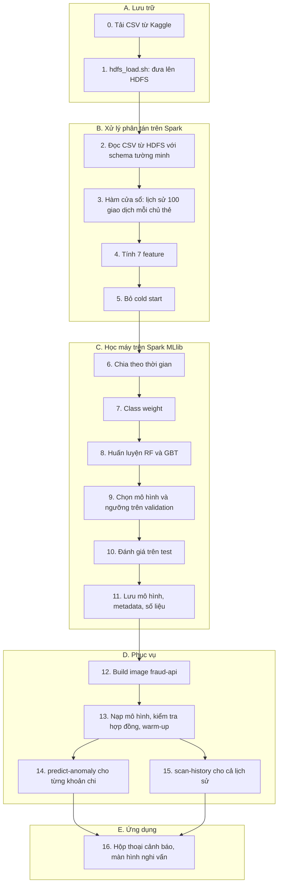
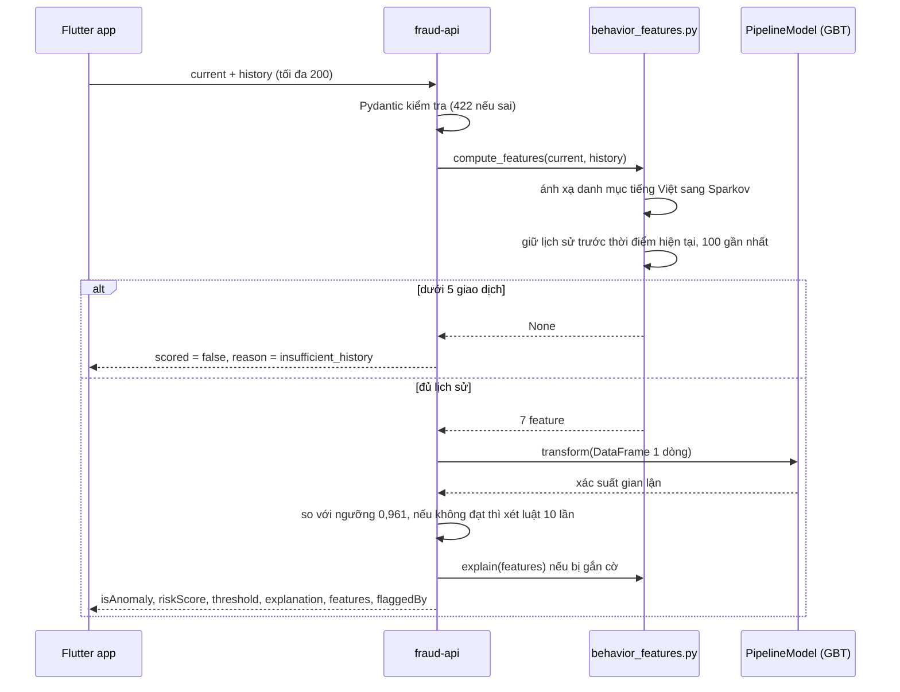

# 02. Luồng Big Data từ file CSV tới màn hình điện thoại

Tài liệu này đi qua toàn bộ đường đi của dữ liệu, theo đúng thứ tự xảy ra. Mỗi giai đoạn ghi rõ: code nào chạy, chạy ở đâu, dữ liệu vào và ra là gì, và con số thật lấy từ file kết quả.

## Toàn cảnh



Bảng dưới cho biết dữ liệu nằm ở đâu và lớn cỡ nào ở mỗi chặng.

| Chặng | Dữ liệu | Nơi nằm | Kích thước |
|---|---|---|---|
| Sau khi tải | 3 file CSV | `data/` trên máy | 335 MB + 143 MB + 144 MB |
| Sau `hdfs_load.sh` | 3 file CSV, chia block 128 MB, mỗi block 2 bản | `hdfs://namenode:8020/data/` | 622,2 MB dữ liệu, chiếm khoảng 1,2 GB đĩa trên hai datanode |
| Trong job Spark | DataFrame có lịch sử và feature | Bộ nhớ executor, cache | 1.852.394 dòng đọc vào, 1.847.399 dòng đủ lịch sử |
| Về driver | Chỉ số tổng hợp: histogram 1.000 bin, ma trận nhầm lẫn, 30 mẫu | Bộ nhớ driver | Vài trăm KB |
| Sau huấn luyện | Mô hình và số liệu | `behavior_model/`, `artifacts/`, `metrics.json` | Mô hình B khoảng 400 KB |
| Lúc phục vụ | 1 giao dịch + tối đa 200 lịch sử | Request HTTP | Vài KB |

## A. Lưu trữ

### Giai đoạn 0: dữ liệu gốc

| Bộ dữ liệu | Nguồn | File | Số dòng | Gian lận | Dùng cho |
|---|---|---|---|---|---|
| Sparkov | Kaggle `kartik2112/fraud-detection` | `data/fraudTrain.csv` | 1.296.675 | 7.506 (0,58%) | Model B, train và validation |
| Sparkov | như trên | `data/fraudTest.csv` | 555.719 | 2.145 (0,39%) | Model B, test |
| Credit Card | Kaggle `mlg-ulb/creditcardfraud` | `data/creditcard.csv` | 284.807 | 492 (0,17%) | Model A |

Sparkov là dữ liệu mô phỏng giao dịch thẻ của khoảng 1.000 chủ thẻ trong hai năm, có cột `cc_num` (chủ thẻ), `trans_date_trans_time`, `category`, `amt`, `is_fraud` và nhiều cột cá nhân. Không có bộ dữ liệu chi tiêu cá nhân thật nào được công bố kèm nhãn, nên nhóm dùng bộ mô phỏng và nói rõ giới hạn này.

Các file CSV không được commit (`.gitignore` chặn `*.csv` và `data/`). Muốn chạy lại phải tải từ Kaggle và đặt đúng tên.

### Giai đoạn 1: đưa lên HDFS

Lệnh: `bash scripts/hdfs_load.sh` (trên Git Bash cho Windows thêm `MSYS_NO_PATHCONV=1` phía trước).

Compose đã mount sẵn thư mục `data/` và file `data/creditcard.csv` vào container namenode ở `/staging/...`, chế độ chỉ đọc. Script chạy các lệnh sau bên trong container namenode:

1. `hdfs dfsadmin -safemode wait`: chờ namenode thoát chế độ an toàn, vì lúc mới khởi động namenode chưa cho ghi.
2. `hdfs dfs -mkdir -p /data/sparkov /data/creditcard`.
3. `hdfs dfs -put -f` hai file Sparkov vào `/data/sparkov/` và file Credit Card vào `/data/creditcard/`. HDFS client cắt mỗi file thành block 128 MB. Với mỗi block, namenode chọn hai datanode (`dfs.replication=2`), client ghi block theo pipeline qua cả hai, còn namenode chỉ lưu metadata: file gồm những block nào và mỗi block nằm ở datanode nào.
4. In bằng chứng: `hdfs dfs -ls -h -R /data`, `hdfs dfs -du -s -h /data` (cột đầu `622.2 M` là kích thước dữ liệu, cột thứ hai là dung lượng tính cả hai bản sao) và `hdfs fsck /data -files -blocks` (kết luận `The filesystem under path '/data' is HEALTHY`).

Từ đây mọi job Spark đọc dữ liệu qua địa chỉ `hdfs://namenode:8020/data/...`, không đọc file trên ổ đĩa máy.

Vì mỗi block có hai bản, mất một datanode không làm mất dữ liệu. `scripts/hdfs_fault_demo.sh` tắt `datanode2` và cho thấy file vẫn đọc được, `fsck` báo 0 block bị mất (chi tiết ở `03_HDFS_SPARK.md`).

## B. Xử lý phân tán trên Spark

Lệnh: `bash scripts/train_on_cluster.sh behavior`. Script gọi `spark-submit` bên trong container `spark-master`:

```bash
/opt/spark/bin/spark-submit \
  --master spark://spark-master:7077 \
  --driver-memory 2g --executor-memory 2560m \
  --conf spark.executor.cores=4 \
  --conf spark.sql.session.timeZone=UTC \
  --py-files /workspace/behavior_features.py,/workspace/behavior_features_spark.py \
  /workspace/train_behavior.py \
  --input-dir hdfs://namenode:8020/data/sparkov \
  --model-output /workspace/behavior_model \
  --artifacts-dir /workspace/artifacts/behavior
```

`--py-files` gửi hai module feature tới executor, vì code chạy trên worker cũng cần import chúng. Job tự đặt thêm `spark.sql.shuffle.partitions=48`.

### Giai đoạn 2: đọc dữ liệu

`read_sparkov()` trong `behavior_features_spark.py`:

- Đọc CSV với `SPARKOV_SCHEMA` khai báo sẵn 23 cột. Không dùng `inferSchema`, vì suy kiểu cần đọc file thêm một lượt.
- Chỉ giữ các cột app cũng biết: `trans_date_trans_time`, `cc_num`, `category`, `amt`, `trans_num`, nhãn `is_fraud` (đổi tên thành `label`). Các cột cá nhân và vị trí (tên, địa chỉ, tọa độ, nghề nghiệp, ngày sinh) bị bỏ ngay từ đầu.
- Thêm cột `source` là `train` hoặc `test` để biết dòng đến từ file nào, rồi `unionByName` hai file thành một DataFrame. Hai file phải đi chung vì lịch sử của một giao dịch đầu file test nằm ở cuối file train.
- `na.drop()` bỏ dòng thiếu giá trị ở các cột đã giữ.

Kết quả đọc (`rowsRead` trong `metrics_behavior.json`): train 1.289.169 bình thường + 7.506 gian lận, test 553.574 bình thường + 2.145 gian lận.

### Giai đoạn 3: lịch sử của từng chủ thẻ bằng hàm cửa sổ

`build_features()`:

1. Đổi chuỗi thời gian thành `local_time` rồi thành số giây `ts`. Phiên Spark đặt múi giờ UTC, nên giờ trong file được đọc nguyên văn, không bị dịch múi giờ.
2. Định nghĩa cửa sổ: `Window.partitionBy("cc_num").orderBy("ts", "trans_num").rowsBetween(-101, -1)`. Spark shuffle dữ liệu theo `cc_num` để mọi giao dịch của một chủ thẻ về cùng một partition, sắp xếp trong partition theo `ts` và `trans_num`, rồi với mỗi dòng lấy tối đa 101 dòng đứng ngay trước nó.
3. `collect_list(struct(ts, amt, category))` trên cửa sổ đó tạo cột mảng `previous`.
4. `filter(previous, x -> x.ts < ts)` bỏ những dòng có cùng thời điểm với giao dịch hiện tại. Lịch sử phải đứng trước một cách nghiêm ngặt, giống hệt API. Đó là lý do cửa sổ lấy 101 thay vì 100: nếu một dòng bị loại vì trùng giờ, vẫn còn đủ 100.
5. `slice(...)` giữ 100 phần tử cuối, tức 100 giao dịch gần nhất. Kết quả là cột `history`.

Đây là bước nặng nhất của job, vì phải shuffle toàn bộ dữ liệu và mỗi dòng mang theo một mảng tới 100 phần tử. Vì vậy chỉ các cột feature được cache, còn mảng `history` thì không.

### Giai đoạn 4: bảy feature

Vẫn trong `build_features()`, dùng hàm bậc cao của Spark SQL (`aggregate`, `filter`, `transform`, `array_max`) trên mảng `history`:

| Feature | Cách Spark tính |
|---|---|
| `hour` | `hour(local_time)` |
| `day_of_week` | `(dayofweek(local_time) + 5) % 7`, để thứ Hai = 0 như Python |
| `category_idx` | Vị trí của danh mục trong danh sách 14 danh mục Sparkov |
| `amt_ratio_user` | `amt / trung bình amt trong history` |
| `amt_ratio_user_cat` | `amt / trung bình amt cùng danh mục trong history`, nếu không có giao dịch cùng danh mục thì lấy `amt_ratio_user` |
| `txn_count_24h` | Số phần tử của history có `ts >= ts_hiện_tại - 86400` |
| `secs_since_prev` | `ts_hiện_tại - max(ts trong history)` |

Spark 4 bật chế độ ANSI, chia cho 0 sẽ lỗi. Code dùng `try_divide` để lịch sử rỗng cho ra NULL thay vì làm hỏng job. Những dòng đó là cold start và bị loại ở bước sau. Chi tiết công thức và ví dụ tính tay: `04_FEATURE_HANH_VI.md`.

### Giai đoạn 5: bỏ cold start

`scorable()` giữ các dòng có `history_count >= 5`. API cũng không chấm khi người dùng có dưới 5 giao dịch trước đó, nên huấn luyện và phục vụ thấy cùng một loại dữ liệu.

Số dòng bị loại: 4.995. Còn lại 1.847.399 dòng (`rowsScorable`).

## C. Học máy trên Spark MLlib

Tất cả trong `train_behavior.py`.

### Giai đoạn 6: chia theo thời gian

- Lấy phần `source = train`, tìm mốc thời gian ở phân vị 90% bằng `approxQuantile("ts", [0.9], 0.0001)`. Mốc là 2020-05-02 14:52:07.
- Train: trước mốc, 1.162.460 dòng, 6.333 gian lận.
- Validation: từ mốc trở đi, 129.300 dòng.
- Test: toàn bộ file `fraudTest` (giai đoạn sau đó), 555.639 dòng.

Không xáo trộn. Mô hình luôn được đánh giá trên giai đoạn mà nó chưa thấy, giống cách nó sẽ được dùng.

### Giai đoạn 7: xử lý mất cân bằng

Tỉ lệ gian lận trong train khoảng 0,5%. Thay vì nhân bản hay bỏ bớt dòng, job thêm cột `classWeight`: lớp gian lận nặng `số dòng bình thường / số dòng gian lận = 182,56`, lớp bình thường nặng 1. Cách này không phải gom dữ liệu về Python và không làm phình dữ liệu.

### Giai đoạn 8: huấn luyện hai ứng viên

Mỗi ứng viên là một `Pipeline` ba bước:

1. `VectorAssembler`: gộp 7 cột feature thành một vector.
2. `VectorIndexer(maxCategories=14)`: feature có không quá 14 giá trị khác nhau được xử lý như biến phân loại (theo chú thích trong code: `category_idx` 14 giá trị, `day_of_week` 7 giá trị).
3. Bộ phân loại, có `weightCol="classWeight"`:
   - Random Forest: 100 cây, sâu tối đa 10, `maxBins` 64, seed 42. Huấn luyện mất 150,2 giây.
   - Gradient-Boosted Trees: 60 vòng, sâu tối đa 6, `maxBins` 64, `stepSize` 0,1, seed 42. Huấn luyện mất 123,7 giây.

### Giai đoạn 9: chọn mô hình và ngưỡng trên validation

Với mỗi ứng viên:

1. Chấm điểm tập validation, lấy xác suất lớp gian lận làm `score`.
2. Tính histogram 1.000 bin của `score` ngay trên Spark (`groupBy("bin")`), mỗi bin đếm số gian lận và số bình thường. Chỉ 1.000 dòng này về driver.
3. Trên driver, quét từ bin cao xuống thấp để có Precision, Recall, F1 tại mọi ngưỡng `bin / 1000`. Chọn ngưỡng có F1 lớn nhất.
4. Tính PR-AUC và ROC-AUC bằng `BinaryClassificationEvaluator`.

Ứng viên có PR-AUC validation cao hơn được chọn: GBT 0,754 so với Random Forest 0,700. Ngưỡng của GBT là 0,961. Test không tham gia vào lựa chọn nào.

### Giai đoạn 10: đánh giá một lần trên test

| Phương pháp | PR-AUC | ROC-AUC | Ngưỡng | Precision | Recall | F1 | Tỉ lệ bị cảnh báo |
|---|---|---|---|---|---|---|---|
| GBT (được chọn) | 0,654 | 0,990 | 0,961 | 0,591 | 0,671 | 0,629 | 0,42% |
| Random Forest | 0,616 | 0,990 | 0,943 | 0,610 | 0,608 | 0,609 | 0,37% |
| Luật `amt_ratio_user_cat >= 3` | | | | 0,027 | 0,492 | 0,051 | 6,84% |

Ma trận nhầm lẫn của GBT: TP 1.385, FP 957, FN 680, TN 552.617. Luật đơn giản bắt được gần một nửa gian lận nhưng cảnh báo 6,84% giao dịch, gần như toàn báo nhầm. Mô hình cảnh báo 0,42% giao dịch và 59% trong số đó là gian lận thật.

### Giai đoạn 11: lưu kết quả

| File | Nội dung |
|---|---|
| `behavior_model/` | `PipelineModel` của GBT (assembler, indexer, cây) dạng Parquet và JSON |
| `behavior_model/behavior_metadata.json` | `modelVersion` (`behavior-gbt-2026-10-07`), thuật toán, danh sách feature theo đúng thứ tự, ngưỡng 0,961, `historyWindow` 100, `minHistory` 5, 14 danh mục, phiên bản Spark |
| `artifacts/behavior/metrics_behavior.json` | Số dòng mỗi chặng, mốc chia, class weight, số liệu validation và test của cả hai ứng viên, feature importance, luật đối chứng, thời gian chạy (370,3 giây) |
| `artifacts/behavior/pr_curve_test.json` | Đường Precision-Recall trên test của mô hình được chọn |
| `artifacts/behavior/parity_sample.json` | 15 giao dịch gian lận và 15 bình thường chọn ngẫu nhiên từ test, kèm lịch sử thô, feature và xác suất mà Spark tính ra |

File cuối là cầu nối giữa huấn luyện và phục vụ: `e2e_check.py` gửi 30 giao dịch này qua API và đòi API tính ra đúng các con số đó.

Notebook `behavior_anomaly_pipeline.ipynb` chạy lại phân tích khám phá trên cụm (giờ, danh mục, phân bố số tiền, tỉ lệ gian lận theo mức lệch thói quen), đọc các file số liệu trên rồi vẽ 5 biểu đồ vào `artifacts/charts/`. Mọi phép `groupBy` chạy trên Spark, chỉ bảng tổng hợp được chuyển sang pandas để vẽ.

### Nhánh phụ: Model A

`bash scripts/train_on_cluster.sh creditcard` chạy `train_pipeline.py` trên `hdfs://namenode:8020/data/creditcard/creditcard.csv`: Random Forest với class weight 577,9, chia ngẫu nhiên 80/20, rồi thí nghiệm điền 0 cho V1 đến V28. Kết quả vào `random_forest_model/` và `metrics.json`. Nhánh này chỉ để chứng minh vì sao app không thể dùng mô hình kiểu ngân hàng. Chi tiết ở `05_HUAN_LUYEN_DANH_GIA.md`.

## D. Phục vụ

### Giai đoạn 12: đóng gói

`docker compose -f docker-compose.bigdata.yml --profile api up -d --build fraud-api` build image từ `Dockerfile`. Image chứa code API và copy sẵn hai thư mục mô hình. Không có volume, nên mô hình trong container là mô hình lúc build.

### Giai đoạn 13: khởi động

Hàm `lifespan` trong `main.py`:

1. Mở `SparkSession` chế độ `local[*]` trong container.
2. Nạp Model A và Model B, mỗi cái trong một khối `try` riêng. Model A hỏng không kéo Model B (cái app cần) chết theo.
3. Khi nạp Model B, `BehaviorEngine.load()` kiểm tra hợp đồng: `featureColumns` trong metadata phải trùng `FEATURE_COLUMNS` của code, `minHistory` phải bằng `MIN_HISTORY`. Lệch là từ chối nạp.
4. Chấm thử một vector toàn số 1 để Spark biên dịch code và khởi tạo luồng trước khi có request thật (warm-up).

`GET /health` trả `modelLoaded`, `behaviorModelLoaded` và `behaviorModelVersion` để biết trạng thái.

### Giai đoạn 14: chấm một khoản chi (`POST /v2/predict-anomaly`)



Điểm quan trọng: API tính feature bằng đúng định nghĩa mà Spark dùng lúc huấn luyện. Cửa sổ 100, điều kiện "trước nghiêm ngặt", ngưỡng 5 và cách đọc thời gian như UTC đều giống. Nhờ đó mô hình trên app là mô hình đã được đánh giá, không phải một bản gần giống.

### Giai đoạn 15: quét cả lịch sử (`POST /v2/scan-history`)

App gửi tối đa 1.000 khoản chi. API sắp xếp theo thời gian một lần, rồi với giao dịch thứ i dùng tối đa 200 giao dịch đứng trước nó làm lịch sử. Mọi dòng đủ điều kiện được gom vào một DataFrame và chấm bằng một lần `transform`, không gọi mô hình từng dòng một. Kết quả: số giao dịch quét, số được chấm, số bị gắn cờ, số bị gắn cờ theo danh mục, và danh sách bị gắn cờ xếp theo điểm giảm dần.

## E. Ứng dụng

### Giai đoạn 16: người dùng thấy gì

- Lưu một khoản chi bị gắn cờ (quét hóa đơn, nhập tay, sửa): hộp thoại "Chi tiêu bất thường so với thói quen" với số tiền, câu giải thích, điểm rủi ro so với ngưỡng (hoặc câu "Khoản này vượt xa mức bạn thường chi nên cần bạn xác nhận." nếu do luật), và hai nút Hủy, Vẫn lưu.
- Trang chủ: banner "Có N giao dịch chi tiêu bất thường" khi lần quét gần nhất có giao dịch bị gắn cờ.
- Tab AI: thẻ "Cảnh báo chi tiêu bất thường".
- Màn hình nghi vấn: "X/Y giao dịch có dấu hiệu bất thường", biểu đồ cột theo danh mục, danh sách có thanh điểm rủi ro.

Chi tiết từng màn hình và cách xử lý lỗi: `07_TICH_HOP_APP.md`.

## Cái gì chứng minh luồng này chạy đúng

| Khẳng định | Bằng chứng |
|---|---|
| Dữ liệu thật sự nằm trên HDFS | Output `hdfs_load.sh` (622,2 MB, HEALTHY), UI 9870 |
| HDFS chịu được mất một datanode | Output `hdfs_fault_demo.sh`: `Dead datanodes (1)`, file vẫn đọc được, `Missing blocks: 0` |
| Spark đọc từ HDFS, chạy trên cụm | `"input": "hdfs://namenode:8020/data/sparkov"` và `"master": "spark://spark-master:7077"` trong `metrics_behavior.json`, UI 8080 |
| Feature lúc phục vụ giống lúc huấn luyện | `e2e_check.py`: 30 giao dịch test, feature lệch không quá `1e-6` (tương đối) và xác suất lệch không quá `2e-6` |
| Mô hình tốt hơn luật đơn giản | F1 0,629 so với 0,051 trên cùng tập test |
| Bước tính feature chạy được khi dữ liệu lớn gấp 8 lần | `artifacts/scale/results.jsonl`: 14.819.152 dòng, CSV 4,08 GB trên HDFS (`REPORT_NOTES.md` mục 7b) |
| App không bị chặn khi API lỗi | Case L1 trong `mobile-app/test/bigdata_cases/` |
